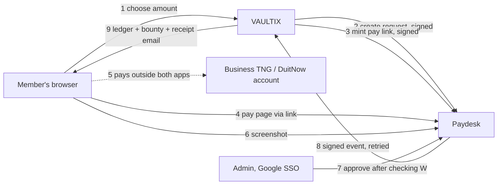
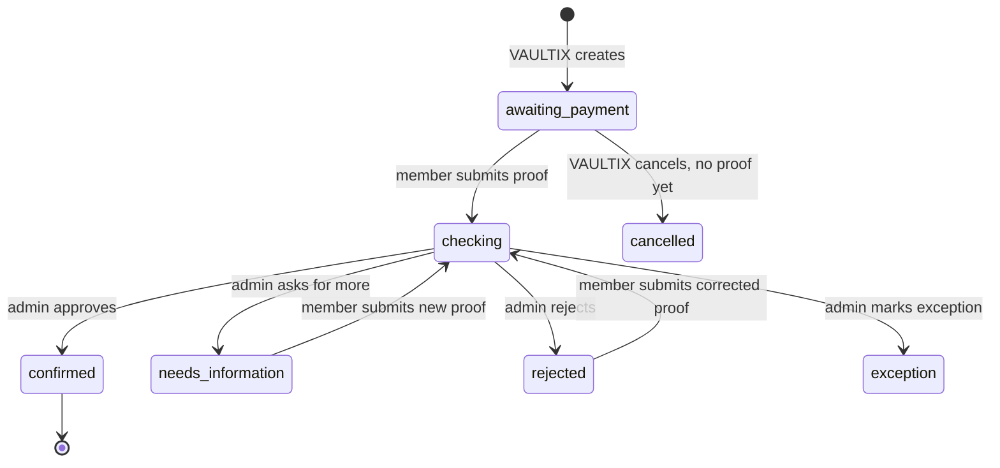

# VAULTIX Paydesk — separate direct-payment app: design

Date: 2026-10-10 (Asia/Kuala_Lumpur). Status: **accepted direction, not implemented. Live
collection stays off until the launch gates in §12 pass.**

Audience: the developer who builds Paydesk (a separate app), and the VAULTIX backend lane that
connects to it. The machine-level contract between the two is in
[`docs/integration/paydesk-vaultix-contract.md`](../../integration/paydesk-vaultix-contract.md).
The member-facing screen already exists in VAULTIX as a fixture preview to copy from (§7).

Background: a draft design by the VAULTIX backend lane (2026-10-09, "direct payment and automatic
confirmation") proposed collecting money through the business TNG link and DuitNow QR inside
VAULTIX. That draft is not merged. This document replaces its answer to *where* payments are
handled and *how much* is charged, using the user's decisions below. Everything needed to build
is restated here; you do not need the draft.

## 1. Decisions taken by the user (2026-10-10)

| # | Decision |
| --- | --- |
| U1 | Payments are handled by a **separate app, Paydesk**, with its own deployment and its own database, connected to VAULTIX through signed server-to-server APIs. Someone other than the VAULTIX lanes builds it. |
| U2 | **Google SSO for Owner/admins only**, limited to an allowlist of email addresses. Members never sign in to Paydesk; they arrive through a short-lived link minted for them by VAULTIX. |
| U3 | The member pays to the business recipient's **supplied DuitNow QR or Touch 'n Go payment link**, typing the amount themselves. Both are static: they carry no amount and no reference. |
| U4 | **The member types the full contribution** (RM10 contribution → type RM10.00). The bounty rises by the full RM10.00 and is shown in full. |
| U5 | **Platform fee 3%, taken only when money leaves escrow**: at payout to the winning Hunter, and also at refund. Not charged on top. |
| U6 | **Refunds also lose 3%**: each refunded contribution is returned minus its own 3% fee. |
| U7 | **Version 1: the Owner approves every payment by hand** after checking the screenshot against the business account's own transaction history. The Android notification API is prepared, but automatic confirmation stays off until its own gate passes (§10). |

### Fee arithmetic (U4–U6)

All amounts are integer sen. The rate is 300 basis points. Every fee rounds **down** to the sen.

- Payout of a bounty `B`: `fee = floor(B × 300 / 10000)`, Hunter receives `B − fee`.
  RM10.00 → fee RM0.30, Hunter RM9.70. RM33.33 → fee RM0.99, Hunter RM32.34.
- Refund of one contribution `C`: `fee = floor(C × 300 / 10000)`, payer receives `C − fee`.
  RM10.00 → RM9.70 back. RM1.00 → fee RM0.03, RM0.97 back.
- Contribution limits are unchanged: 100–5,000 sen (RM1–RM50) per contribution.

The fee model is **snapshotted on each Wanted when it is published**, like today's rate. A Wanted
published under the current model (10% charged on top, full refund of contribution + fee) keeps
that model for its whole life. Only Wanteds published after the switch use U4–U6.

**Before launch** the Terms of Use and Refund Policy pages must say that 3% is kept on a refund
(today they promise a full refund). That is a legal launch gate (§12), not a code detail.

## 2. Scope

In scope for Paydesk v1:

1. Admin sign-in with Google, allowlisted; admin roles and audit log.
2. Payment method configuration (the QR image, the TNG link, the recipient's display name),
   versioned.
3. Payment requests created by VAULTIX, with idempotent creation and cancellation.
4. A member payment page reached by a short-lived link: amount, QR, link, screenshot upload,
   status.
5. Private, versioned screenshot proof storage.
6. Admin review queue: approve, ask for more information, reject, mark an exception.
7. A durable outbox that tells VAULTIX each decision, retried until acknowledged.
8. Read API for VAULTIX reconciliation.

Out of scope for v1: automatic confirmation, OCR, payer email or notifications (VAULTIX sends
member email), payouts and refunds (still executed by the Owner and recorded in VAULTIX), any
VAULTIX data beyond what the contract sends.

## 3. Architecture

Recommended stack, matching VAULTIX so its patterns can be copied: Next.js App Router, strict
TypeScript, Zod at every boundary, Supabase (a **new, separate project**: Postgres with RLS,
private Storage, Auth with the Google provider), deployed on its own Vercel project. Any
equivalent stack is acceptable if it meets every requirement in this document.

Hard boundaries:

- Paydesk never connects to the VAULTIX database and VAULTIX never connects to Paydesk's. They
  talk only through the contract.
- Screenshots and payer-typed references never leave Paydesk. VAULTIX receives decisions, not
  evidence.
- Paydesk never sees member names or emails. It knows a VAULTIX intent id, an opaque payer
  reference, the amount, and the Wanted's public title and link.
- No secret (Supabase service role, signing secrets, Google client secret) reaches a browser
  bundle or a log line.

## 4. Data model (Paydesk database)

All tables have RLS enabled. Members have no database role at all: every member action goes
through a server route that has checked the pay-link token. Admin reads go through server code
that has checked the session and the allowlist. Money is `integer` sen with `check` constraints;
never `numeric` floats in application code.

| Table | Purpose and key constraints |
| --- | --- |
| `admins` | `email` (unique, lower-case), `role` (`owner` or `reviewer`), `active`, `payer_refs text[]` (the admin's own VAULTIX payer references, for D6), timestamps. Only an `owner` changes this table. |
| `payment_methods` | `id`, `kind` (`duitnow_qr` or `tng_link`), `recipient_name`, `qr_object_key` or `href`, `config_version`, `active`. Changing a method creates a new version; old versions are kept. |
| `payment_requests` | `id uuid`, `vaultix_intent_id` (unique), `purpose` (`publish` or `back`), `amount_sen` (`check between 100 and 5000`), `currency` (`MYR`), `wanted_id`, `wanted_title`, `wanted_url`, `payer_ref`, `policy_version`, `method_config_version` (snapshot), `status`, `version int` (bumped on every change), `created_at`, `cancelled_at`, `confirmed_at`. |
| `pay_links` | `token_hash` (SHA-256 of the token, unique), `request_id`, `expires_at`, `created_at`. The raw token is never stored. |
| `proofs` | `id`, `request_id`, `version` (unique per request, from 1), `bucket`, `object_key`, `sha256`, `size_bytes`, `mime`, `payer_reference` (nullable, as typed), `paid_at` (nullable), `submitted_at`, `state`. Insert-only. |
| `decisions` | `id`, `request_id`, `proof_id`, `action` (`approve`, `needs_information`, `reject`, `exception`), `reason_code`, `user_message`, `next_step`, `received_amount_sen`, `provider_reference`, `admin_email`, `request_version` (the version the admin saw), `decided_at`. Insert-only. |
| `confirmations` | `request_id` (unique), `decision_id`, `provider_reference`, `amount_sen`, `confirmed_at`. Unique on `provider_reference`: **one business-account transaction can confirm at most one request.** |
| `outbox_events` | `event_id uuid` (unique), `request_id`, `type`, `payload jsonb`, `attempts`, `next_attempt_at`, `delivered_at`, `last_status`, `dead_lettered_at`. |
| `audit_log` | Every admin sign-in, decision, method change and admin change: who, what, when, request id. Insert-only. |
| `nonces` | Seen request nonces for inbound signed calls, kept 15 minutes. |

Insert-only means: no `update` or `delete` grant to any application role, enforced by trigger as
well as grants.

## 5. Request lifecycle

Rules:

- `confirmed` is final. Nothing reopens it. A correction after confirmation is a VAULTIX-side
  compensating entry, decided by the Owner there.
- `cancelled` is allowed only from `awaiting_payment` with **no proof**. Once a member has sent
  proof, money may exist, so the request is never cancelled; it can only be decided.
- `exception` means "money may have arrived but cannot be confirmed as is" (for example the
  received amount differs). It leaves the normal flow and waits for D5 (§11). It never becomes a
  confirmation by editing the amount.
- Every transition increments `version`. Every admin decision carries the version the admin was
  looking at; if a newer proof arrived meanwhile, the decision is refused (409) and the admin
  sees the new proof.

## 6. Admin access (Google SSO)

- Sign-in uses Supabase Auth's Google provider. The Google OAuth client belongs to the business's
  Google Cloud project; its secret lives only in Supabase and the server environment.
- After sign-in, the server accepts the session only if Google reports the email as verified
  **and** the email is in `admins` with `active = true`. Anyone else is signed out at once and
  shown "This account is not authorised for Paydesk." No sign-up exists.
- Admins should have Google 2-Step Verification on. Paydesk cannot enforce it, so it is a launch
  checklist item (§12).
- **Recent sign-in for money decisions:** approve, reject, needs-information and exception
  require a sign-in within the last 30 minutes; otherwise Paydesk sends the admin back through
  Google first and returns them to the same request.
- Roles: `owner` can do everything, including editing admins and payment methods. `reviewer` can
  review and decide but cannot change admins or methods.
- Sessions expire after 12 hours of inactivity.

## 7. Member payment page

Reached only through a pay link minted by VAULTIX (`/pay/{token}`). The page is `no-store`, sends
`Referrer-Policy: no-referrer`, and is not indexed.

Reference implementation for layout, wording and every state: the VAULTIX fixture preview,
`src/components/payments/` and `/payment/requests/preview` on a VAULTIX development server. Copy
its words and states, replacing the amount rules with U4 (no fee line: "Amount to enter" equals
the contribution). Plain English, keyboard operable, usable from 360 px wide, WCAG 2.1 AA.

The page shows:

1. The Wanted's title, the request reference and the request's status.
2. **Amount to enter**, exact, with a copy button that copies the bare figure (`10.00`). A note
   that the QR and the link do not fill in the amount or any reference.
3. The recipient's display name, to check in the payer's app before confirming.
4. The DuitNow QR image exactly as supplied (never redrawn, recompressed or resampled; white
   quiet zone) and an "Open payment link" button for TNG that opens in a new tab.
5. The proof form: screenshot (required; PNG or JPEG), payment reference if shown (optional,
   max 64 characters), date and time paid (optional, Malaysia time).
6. The history of screenshots sent, each with its state, and the latest decision's message and
   next step.

Behaviour that must hold:

- The amount comes from the saved request, never from the address bar.
- Payment instructions (QR, link, amount to type) show **only** in `awaiting_payment`. In every
  other state the member is told plainly whether to do anything and never asked to pay again.
- After proof: "Proof received; payment not yet confirmed. Do not pay again."
- `needs_information` and `rejected` show the admin's message and next step and accept a new
  screenshot on the same request. Earlier screenshots stay.
- `confirmed` says it is confirmed and links back to the Wanted on VAULTIX, where the receipt
  lives.
- The member never downloads a screenshot back; the page lists proofs by version and state only.
- An expired link shows "This link has expired. Go back to VAULTIX to continue this payment."
  with a link to the Wanted.

Screenshot upload: the browser asks the server for a one-time signed upload to
`proofs/{requestId}/{version}/{random}` in a private bucket, uploads directly, then calls
"complete". The server then checks the object exists, its size, its SHA-256, and its first bytes
against the PNG or JPEG signature before inserting the `proofs` row. No image decoding or OCR on
the server. Size limit: proposed 8 MB, pending D4.

## 8. Admin review

- **Queue**: requests in `checking`, oldest first, with amount, purpose, Wanted title, latest
  proof time and how many proofs. Separate tabs for `exception`, `needs_information`, `rejected`
  and recently `confirmed`.
- **Request page**: the screenshot through a short-lived signed URL (5 minutes) rendered inline
  in a sandboxed frame; the payer's typed reference and time; every earlier proof and decision.
- **Approve** requires the admin to type, from the business account's own history:
  - the **transaction number** (`provider_reference`) of the matching incoming payment;
  - the **amount received**.
  Approval is refused unless the amount received equals `amount_sen` exactly, the transaction
  number has never confirmed another request, the admin's sign-in is recent (§6), and the
  request version matches. A name or screenshot alone is never enough.
- **Needs information** and **Reject** require a reason code and a member-facing message and next
  step (§8.1). Neither says no money arrived.
- **Exception** requires an internal note. Use it when money arrived but cannot be approved
  (wrong amount, two possible requests, a payment after the Wanted closed).
- **Self-approval (D6, default until decided):** an admin may not decide a request whose
  `payer_ref` is in their own `payer_refs`. Another admin must decide it. With only one admin, such
  requests wait in the queue.
- Approve, the `confirmations` row, the decision, the status change, the version bump, the audit
  row and the outbox event are written **in one database transaction**.

### 8.1 Member-facing reasons

| Code | Message | Next step |
| --- | --- | --- |
| `unreadable` | The payment reference or amount is not readable. | Upload a clearer screenshot to this request. You do not need to pay again. |
| `wrong_screen` | This screenshot does not show a completed payment. | Upload the screen that shows the successful payment. You do not need to pay again. |
| `recipient_mismatch` | This screenshot does not show a payment to the recipient named on this page. | If you transferred money, upload the correct screenshot or contact payment support with this request's reference. |
| `not_found` | We could not find this payment in the recipient's account. | If you paid, upload a screenshot showing the transaction reference, or contact payment support with this request's reference. |

New codes need the same three parts. Messages never contain internal notes.

## 9. Talking to VAULTIX

Summary here; exact bodies, headers and status codes are in the contract document.

- VAULTIX → Paydesk: create a request, mint a pay link, read a request, cancel a request.
- Paydesk → VAULTIX: one event per decision: `payment.confirmed`, `payment.needs_information`,
  `payment.rejected`, `payment.exception`, and `payment.proof_received` (for VAULTIX's own status
  display).
- Both directions are signed with HMAC-SHA256 over method, path, timestamp, nonce and body
  digest, with separate secrets per direction and per environment.
- Paydesk delivers events from the outbox with retries and backoff until VAULTIX answers 2xx. The
  same `eventId` is reused for every retry, and VAULTIX processes each `eventId` once.

### 9.1 What VAULTIX must change (VAULTIX backend lane)

1. Add `paydesk` as a payment provider and payment mode. Existing ToyyibPay and `mock` bills and
   their callbacks keep working for anything already in flight.
2. Snapshot the new fee model on publication: policy version `2026-10-10`, model
   `deduct_at_settlement`, rate 300 bps. Existing Wanteds keep their snapshot.
3. Contribution intent for `paydesk`: charge = contribution only (no fee line), then call Paydesk
   to create the request using the intent id as the idempotency key.
4. "Continue payment" on VAULTIX mints a fresh pay link through Paydesk and redirects. VAULTIX
   never stores the link.
5. New route `POST /api/payments/paydesk/events`: verify the signature, record the event as a
   provider event (unique on `eventId`), then:
   - `payment.confirmed` → the existing exactly-once contribution path, with the confirmed amount
     and the Paydesk transaction number as provider reference. A first payment publishes the
     Wanted; a backing raises its bounty. Then a receipt notification and email.
   - `payment.needs_information` / `payment.rejected` → inbox notification and email with the
     message and next step, no money change.
   - `payment.exception` → inbox notification ("Your payment needs resolving. You do not need to
     pay again."), no money change.
6. Ledger for the new model (all balanced, append-only):

   | Event | Debit | Credit |
   | --- | --- | --- |
   | Contribution `C` confirmed | `platform_cash` C | `wanted_escrow` C |
   | Payout of bounty `B`, fee `F` | `wanted_escrow` B | `payout_disbursement` B − F; `platform_fee_revenue` F |
   | Refund of contribution `C`, fee `f` | `wanted_escrow` C | `refund_disbursement` C − f; `platform_fee_revenue` f |

   `platform_fee_held` is not used by the new model. The Owner's removal with forfeiture is
   unchanged.
7. Payout and refund task amounts show the fee and the net amount, so the Owner sends the right
   sum.
8. Update the Terms of Use and Refund Policy pages before launch, and update
   `context/project-overview.md` and `context/architecture.md` in the same change that
   implements the model.

## 10. Android notification API (later phase)

The developer reference already published at VAULTIX `/developers/payment-device-api` (unlisted)
describes it. Under this design those endpoints are served by **Paydesk**, not VAULTIX. In
Paydesk, observations are stored as untrusted evidence and shown to the admin beside a request
("an incoming payment of RM10.00 was seen at 14:03"). They never approve anything in v1.
Automatic approval requires, at least: proof that the source notifications are authentic, a
reliable one-to-one link between a business-account transaction and one request, duplicate and
offline tests, and an explicit, audited Owner decision to switch it on.

## 11. Open decisions

Each has a safe default that Paydesk must implement until it is decided.

| ID | Question | Default until decided |
| --- | --- | --- |
| D2 | Legal operator named on receipts and terms; permission to use the business account for VAULTIX; complaints route. | No live collection. |
| D3 | Request lifetime; what happens to a payment confirmed after its Wanted closed, expired or was withdrawn (today VAULTIX queues a refund; under U6 that refund would lose 3%). | No expiry on Paydesk requests. VAULTIX routes late confirmations to the Owner, not to an automatic refund. |
| D4 | Screenshot size and format limits; how long screenshots and payer references are kept; privacy notice wording. | PNG/JPEG, 8 MB proposed; nothing is deleted automatically. |
| D5 | Wrong amount, overpayment, two transfers for one request, money with no request. | `exception`; the Owner resolves outside the normal flow. |
| D6 | May an admin approve their own payment? | No; another admin decides. |
| D7 | When automatic confirmation from the Android app may be switched on. | Off. |
| D8 | The QR's merchant category code is 5499 (convenience/food stores). Is that acceptable to the bank for this use? | Ask the bank before launch. |
| D9 | Hosting cost and plan for a second Supabase and Vercel project. | Free tiers in development only. |

## 12. Launch gates

Live collection stays off until all of these are true and the Owner records the decision:

1. D2, D3 and D4 decided, and the Terms of Use, Refund Policy and Privacy Notice updated.
2. Every admin has Google 2-Step Verification on; the allowlist is reviewed.
3. All tests in §13 pass in an isolated environment; RLS and grants tested with real roles.
4. The VAULTIX side (§9.1) is merged, and its tests pass.
5. One controlled real payment of RM1.00 by the Owner (approved by a second admin, per D6)
   flows end to end: request, payment, proof, approval, VAULTIX bounty and receipt.
6. A kill switch exists on both sides: Paydesk can stop accepting new proofs, and VAULTIX can
   stop creating new requests, without losing anything in flight.

## 13. Testing required

- Unit: fee arithmetic (including RM1.00, RM33.33, RM50.00), token hashing, signature build and
  check, status transitions, reason catalogue.
- Database: RLS and grants deny members and reviewers what they must not do; insert-only tables
  refuse update and delete; one transaction number cannot confirm two requests; a stale
  `request_version` is refused.
- Integration: idempotent create (same body → same request; different body → 409); expired and
  unknown pay links; upload with wrong size, wrong checksum, wrong file signature, missing
  object; approval rollback when any write fails; outbox retry after a VAULTIX timeout, a
  VAULTIX 500 and a lost acknowledgement, with exactly one ledger posting in VAULTIX.
- Security: unsigned, wrongly signed, replayed (same nonce) and stale (timestamp skew) calls
  refused; a non-allowlisted Google account is signed out; a reviewer cannot change admins or
  methods; screenshot URLs expire.
- End to end: both purposes (publish and back), each member-visible state, keyboard only, at
  360 px.

## 14. Build order

1. Foundation: project, Google SSO with allowlist, admins, audit log, payment methods.
2. Requests and pay links: the VAULTIX-facing create, link, read and cancel endpoints with signing.
3. Member page and proof upload.
4. Admin review and decisions.
5. Outbox delivery to VAULTIX (with a stub VAULTIX receiver for tests).
6. VAULTIX changes (§9.1), by the VAULTIX backend lane.
7. Launch gates (§12).
8. Later: Android observations (§10).

Each step ships with its tests and must be deployable without enabling live collection.
